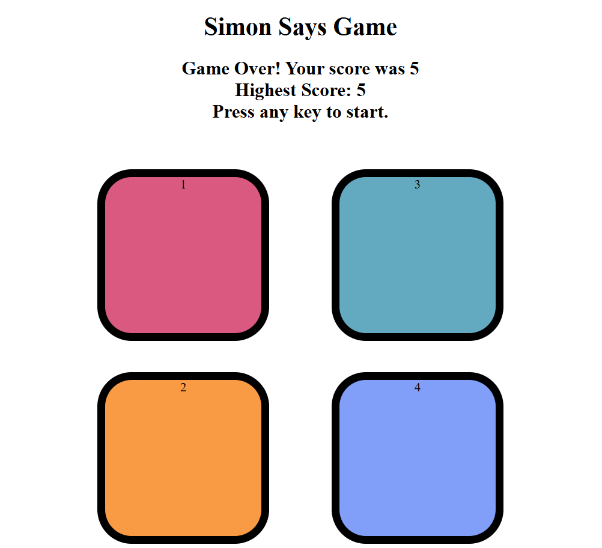

# 🎮 Simon Says Game

A fun and interactive memory-based game built using HTML, CSS, and JavaScript.

## 🚀 Live Demo

[Play Simon Says Game](https://mohdhusainnn.github.io/Simon-Says-Game/)

## ✨ Features

- Interactive Simon Says memory game.
- Four colourful buttons: Yellow, Red, Purple and Green.
- Random colour sequence generation.
- Level-based gameplay.
- User input validation.
- Game Over detection.
- Highest score tracking.
- Persistent Highest Score using JavaScript Local Storage (`localStorage`).

## 🛠️ Technologies Used

- HTML5
- CSS3
- JavaScript
- DOM Manipulation
- Browser Local Storage

## 📸 Screenshots

### Game Start

### Gameplay

### Game Over

## 🎯 How to Play

1. Press any key to start the game.
2. Watch the colour sequence carefully.
3. Click the buttons in the same order.
4. Each level adds a new colour to the sequence.
5. Continue as long as you remember the sequence.
6. Your highest score is saved automatically.

## 👨‍💻 Author

Mohammad Hussain

GitHub: [mohdhusainnn](https://github.com/mohdhusainnn)
